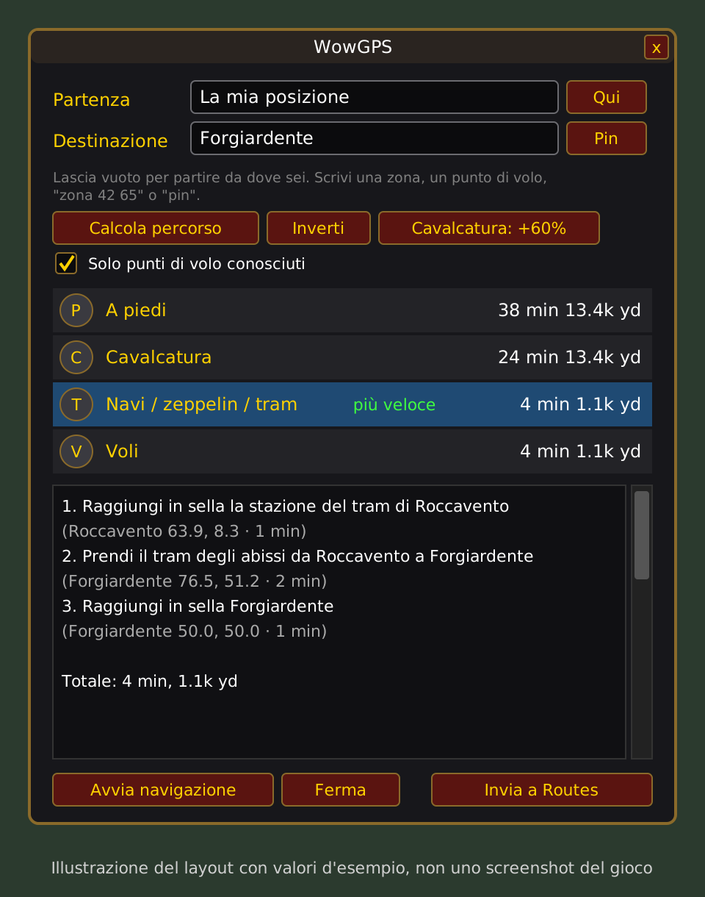
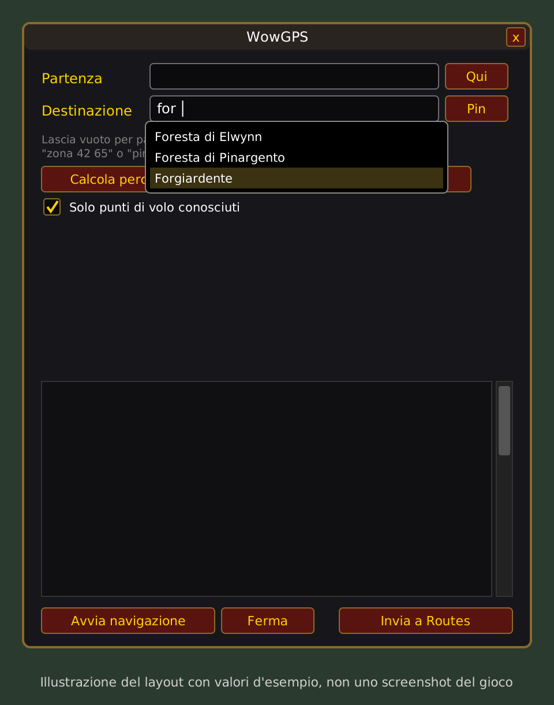

# WowGPS

*[Read me in English](README.md)*

Navigatore in stile Google Maps per **World of Warcraft: Forever** (Interface 16001).
Scegli una partenza e una destinazione e WowGPS ti propone quattro modi di arrivarci, con tempo stimato e indicazioni tappa per tappa:

| Opzione | Cosa usa |
| --- | --- |
| A piedi | solo terra, a velocità di corsa (navi/zeppelin solo se non esiste un percorso via terra) |
| Cavalcatura | solo terra, a velocità di cavalcatura (+60% o +100%) |
| Navi / zeppelin / tram | terra più trasporti pubblici e portale di Darnassus |
| Voli | tutto quanto sopra più i punti di volo |

## Anteprima

Illustrazioni del layout con valori d'esempio: non sono screenshot presi in gioco, dove la finestra usa la grafica standard di WoW.

| Percorso calcolato | Suggerimenti mentre scrivi |
| --- | --- |
|  |  |

## Installazione

Copia la cartella `WowGPS` in `World of Warcraft\_forever_\Interface\AddOns\`.
Addon opzionali: **Routes** e **TomTom**.

## Uso

`/gps` apre la finestra. Nei campi Partenza e Destinazione puoi scrivere:

- niente (o `qui`): la tua posizione
- una zona, una città, un punto di volo, un molo: `Ironforge`, `Booty Bay`
- una zona con coordinate: `Paludi Grigie 10 60`
- solo coordinate nella zona in cui sei: `42 65`
- `pin`: il pin che hai messo sulla mappa del mondo
- `Routes: <nome>`: il primo nodo di un percorso salvato in Routes

Mentre scrivi compaiono i suggerimenti. Scegli un'opzione, poi **Avvia navigazione**.

Comandi rapidi:

```
/gps <luogo>              percorso dalla tua posizione
/gps da <A> a <B>         percorso tra due luoghi (anche: from <A> to <B>)
/gps go [1-4]             avvia la navigazione (numero dell'opzione)
/gps stop | next          ferma / salta una tappa
/gps routes               invia il percorso a Routes
/gps routes clear         rimuove da Routes i percorsi creati da WowGPS
/gps mount 0|60|100       velocità della cavalcatura
/gps lang it|en           lingua dell'addon
/gps mark                 stampa la tua posizione (per correggere i dati)
```

## Lingua

L'addon è in inglese. Con il client di gioco in italiano passa da solo all'italiano; `/gps lang en` o `/gps lang it` forza una delle due. I nomi dei luoghi seguono sempre la lingua del client.

## Navigazione a waypoint

Durante la navigazione c'è un waypoint alla volta, che avanza da solo quando arrivi alla tappa.
Con TomTom installato viene usata la sua freccia; altrimenti il pin nativo della mappa.

## Integrazione con Routes

- **Invia a Routes**: i tratti via terra del percorso diventano percorsi di Routes (uno per zona, chiamati `WowGPS: <destinazione>`). Routes li disegna su mappa e minimappa e la sua funzione waypoint (con TomTom) può seguirli nodo per nodo. Compaiono nella lista di `/routes` dopo un `/reload`.
- **Percorsi di Routes come luoghi**: ogni percorso salvato in Routes si può usare come partenza o destinazione, ad esempio per raggiungere il tuo giro di raccolta.

## Come funziona e limiti

- I **punti di volo** sono letti dal client, quindi include anche quelli nuovi di Forever. Quali conosci viene imparato la prima volta che apri un maestro di volo su ogni continente; fino ad allora WowGPS li considera tutti disponibili e te lo segnala.
- I **confini tra zone, moli, torri e tram** sono in `WowGPS/Data.lua`. Le coordinate sono quelle del mondo classico e sono **approssimative**: vai sul punto giusto, scrivi `/gps mark` e correggi la riga.
- Dentro una zona il percorso è una linea retta tra i punti (con un margine del 20%): non conosce strade, montagne o fiumi.
- Le zone nuove di Forever non hanno ancora confini in `Data.lua`: lì il percorso via terra è una linea retta, segnalata come stima.
- Tempi di attesa di navi, zeppelin e tram sono medie stimate.

## Sviluppo

I test girano fuori dal gioco su Lua 5.1 con un'API di WoW simulata:

```
pip install lupa
python3 tests/run.py
```
