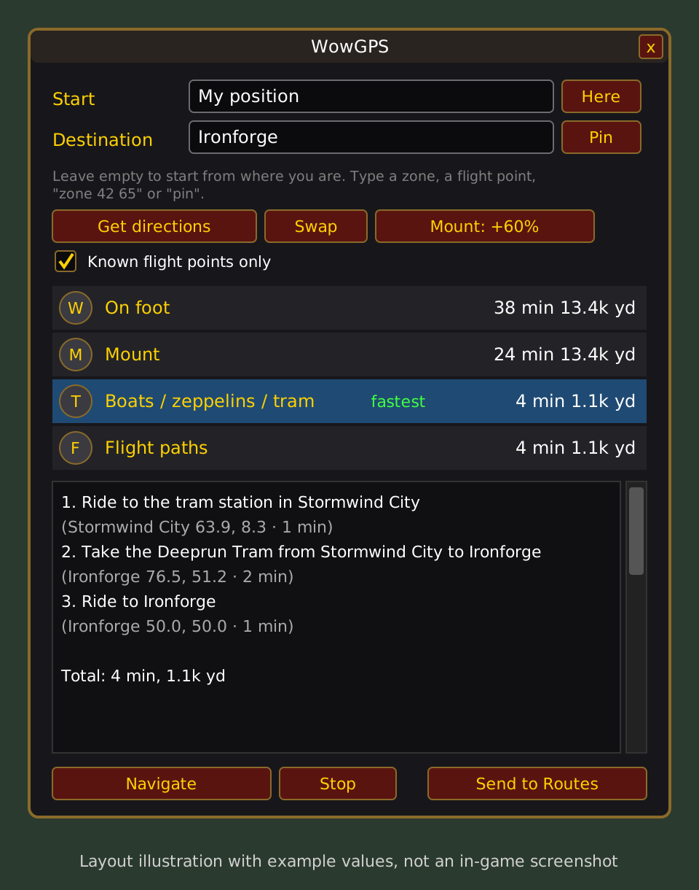
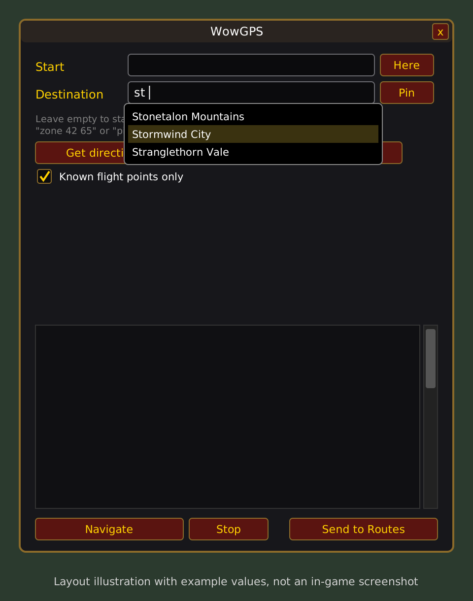

# WowGPS

*[Leggimi in italiano](README.it.md)*

A Google Maps style navigator for **World of Warcraft: Forever** (Interface 16001).
Pick a start and a destination and WowGPS offers four ways to get there, each with an estimated time and step-by-step directions:

| Option | What it uses |
| --- | --- |
| On foot | ground only, at running speed (boats/zeppelins only when there is no land route) |
| Mount | ground only, at mount speed (+60% or +100%) |
| Boats / zeppelins / tram | ground plus public transport and the Darnassus portal |
| Flight paths | all of the above plus flight points |

## Preview

Layout illustrations with example values: these are not in-game screenshots, where the window uses the standard WoW artwork.

| Computed route | Suggestions as you type |
| --- | --- |
|  |  |

## Installation

Copy the `WowGPS` folder into `World of Warcraft\_forever_\Interface\AddOns\`.
Optional addons: **Routes** and **TomTom**.

## Usage

`/gps` opens the window. In the Start and Destination fields you can type:

- nothing (or `here`): your position
- a zone, a city, a flight point, a dock: `Ironforge`, `Booty Bay`
- a zone with coordinates: `Wetlands 10 60`
- coordinates only, in the zone you are in: `42 65`
- `pin`: the pin you placed on the world map
- `Routes: <name>`: the first node of a route saved in Routes

Suggestions appear as you type. Pick an option, then press **Navigate**.

Quick commands:

```
/gps <place>              directions from your position
/gps from <A> to <B>      directions between two places
/gps go [1-4]             start navigation (option number)
/gps stop | next          stop / skip a step
/gps routes               send the route to Routes
/gps routes clear         remove the routes WowGPS created in Routes
/gps mount 0|60|100       mount speed
/gps lang en|it           addon language
/gps mark                 print your position (to fix the data)
```

## Language

The addon is in English. On an Italian game client it switches to Italian automatically; `/gps lang en` or `/gps lang it` forces one or the other. Place names always follow the language of your game client.

## Waypoint navigation

While navigating there is one waypoint at a time, and it advances by itself when you reach the step.
With TomTom installed its arrow is used; otherwise the built-in map pin.

## Routes integration

- **Send to Routes**: the ground segments of the route become Routes routes (one per zone, named `WowGPS: <destination>`). Routes draws them on the map and minimap, and its waypoint feature (with TomTom) can follow them node by node. They show up in the `/routes` list after a `/reload`.
- **Routes routes as places**: every route saved in Routes can be used as a start or a destination, for example to travel to your gathering loop.

## How it works and limits

- **Flight points** are read from the game client, so new Forever ones are included. Which ones you know is learned the first time you open a flight master on each continent; until then WowGPS treats them all as available and tells you so.
- **Zone borders, docks, towers and the tram** live in `WowGPS/Data.lua`. The coordinates come from the classic world and are **approximate**: stand on the right spot, type `/gps mark` and fix the line.
- Inside a zone the route is a straight line between points (with a 20% margin): it does not know roads, mountains or rivers.
- New Forever zones have no borders in `Data.lua` yet: there the ground route is a straight line, flagged as an estimate.
- Waiting times for boats, zeppelins and the tram are estimated averages.
- Not tested in game yet: the logic is covered by the out-of-game tests below.

## Development

The tests run outside the game on Lua 5.1 against a simulated WoW API:

```
pip install lupa
python3 tests/run.py
```
